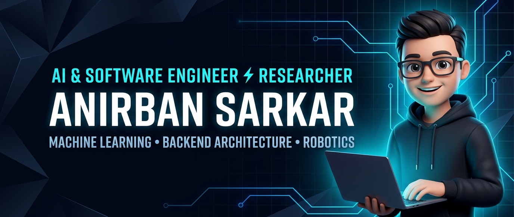

  

<h2 align="center">Anirban Sarkar</h2>

<h3 align="center">AI & Software Engineering Undergraduate | Machine Learning | Backend Systems</h3>

  Third-year B.Tech Computer Science & Engineering (Artificial Intelligence) student at <strong>Brainware University</strong> (Expected Graduation: 2028). 
  Focused on building robust, explainable, and scalable software systems across applied machine learning, high-performance backends, and autonomous robotics.

  
  
  
  

---

## Connect With Me

* **LinkedIn:** [linkedin.com/in/AnirbanSarkar](https://linkedin.com/in/AnirbanSarkar)
* **Personal Portfolio:** [portfolio-chi-six-1rjbyr5rd0.vercel.app](https://portfolio-chi-six-1rjbyr5rd0.vercel.app/)
* **Email:** [sarkaranirban405@gmail.com](mailto:sarkaranirban405@gmail.com)
* If you have technical inquiries, engineering discussions, or collaboration opportunities, feel free to reach out.

---

## Current Projects

* **[TruthShield (Fake-News-Detector)](https://github.com/AnirbanSarkar225/Fake-News-Detector):** Explainable AI platform analyzing news credibility across **128,769 verified articles** using a 4-model ensemble (89.92% test accuracy, 0.9652 ROC-AUC) with SHAP feature attribution and Google Fact Check API integration.
* **[AlphaRail](https://github.com/AnirbanSarkar225/AlphaRail):** Operational railway telemetry and digital twin simulation dashboard using **FastAPI**, asynchronous **PostgreSQL**, and OpenWeatherMap hazard modeling.
* **[AegisNav](https://github.com/AnirbanSarkar225/AegisNav):** Modular autonomous robot navigation framework built across 7 progressive milestones using **ROS 2 Jazzy**, **Gazebo Harmonic**, and pure-Python A* path planning with 98.7% unit test coverage.
* **[Inventory Management System](https://github.com/AnirbanSarkar225/InventoryManagementSystem):** 3-tier enterprise desktop system in **Java 21 & PostgreSQL** implementing DAO and Service design patterns, Role-Based Access Control (RBAC), and automated JUnit 5 test suites.
* **[Gita-NeuroSync (Mind-health)](https://github.com/AnirbanSarkar225/Mind-health):** Biosignal IoT telemetry platform bridging ESP32 hardware streaming with real-time state classification, **PostgreSQL** persistence, and **Google Gemini LLM** cognitive reappraisal.

---

## Current Learning & Research

* **Advanced Generative AI & LLMs:** Fine-tuning Transformer architectures, Retrieval-Augmented Generation (RAG) pipelines, and ONNX Runtime graph acceleration.
* **Autonomous Robotics:** Custom ROS 2 Nav2 recovery behaviors, dynamic obstacle costmap inflation layers, and SLAM in Gazebo.
* **Backend Scalability:** High-concurrency asynchronous microservices, event-driven architectures, and relational query optimization in PostgreSQL.
* **Explainable AI (XAI):** Sentence-level attention visualization and cooperative game-theoretic feature attribution.

---

## Technical Competencies

  <strong>Programming Languages:</strong> 
  
  
  
  

  <strong>Database & Persistence:</strong> 
  
  

  <strong>AI, Machine Learning & NLP:</strong> 
  
  
  
  
  
  

  <strong>Backend & Systems Architecture:</strong> 
  
  
  
  

  <strong>Robotics & Engineering Tools:</strong> 
  
  
  
  
  
  
  

---

  <em>Engineering practical, transparent, and resilient systems from first principles.</em>

